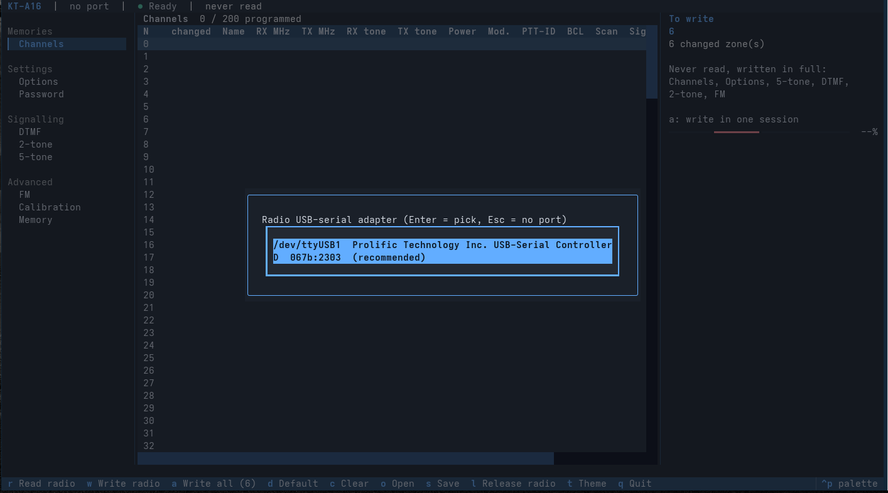
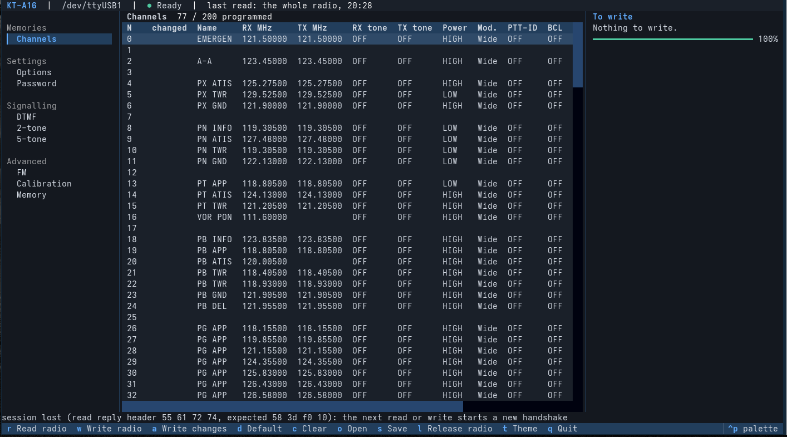
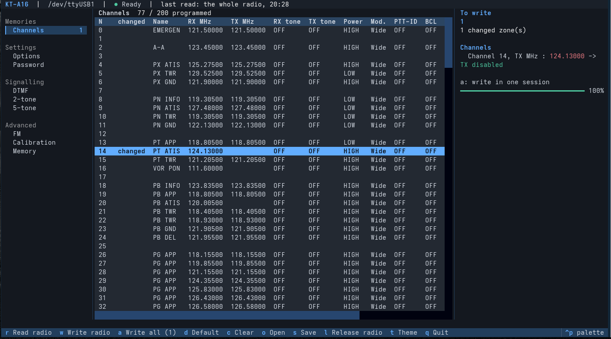
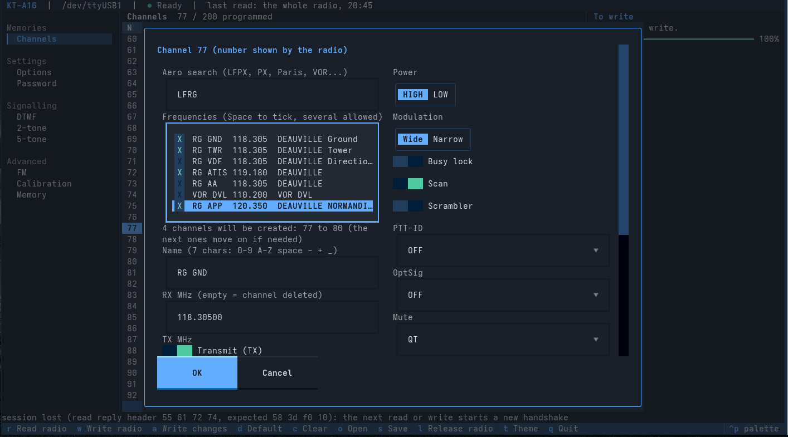
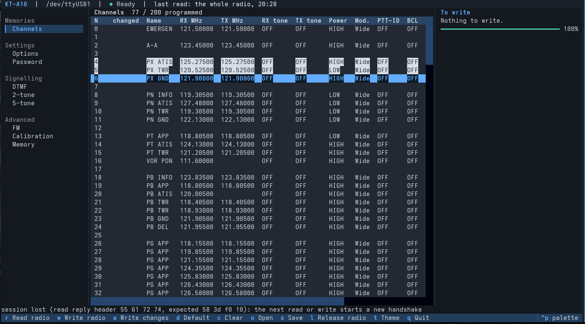

# kta16 : programmer la radio QYT KT-A16 sous Linux

[](pyproject.toml)
[](https://www.repostatus.org/#active)
[](LICENSE)
[](https://github.com/pierrehenrymuller/radio-qyt-kt-a16/actions/workflows/tests.yml)
[](https://github.com/pierrehenrymuller/radio-qyt-kt-a16/actions/workflows/build.yml)
[](https://github.com/pierrehenrymuller/radio-qyt-kt-a16/actions/workflows/codeql.yml)
[](https://github.com/pierrehenrymuller/radio-qyt-kt-a16/actions/workflows/tests.yml)
[](https://github.com/pierrehenrymuller/radio-qyt-kt-a16/releases)

> [!WARNING]
> **Il est interdit d'émettre sur les bandes aviation sans licence de
> radiotéléphonie aéronautique ou licence de pilote.** Cet outil peut
> programmer une radio pour qu'elle émette sur des fréquences aviation. Il ne
> l'empêche pas : vous êtes responsable du respect de la réglementation radio
> de votre pays.

Un programme en terminal (TUI) qui fait ce que fait le logiciel Windows du
fabricant `KT_A16_CPS.exe` : canaux, options, DTMF, 2-tone, 5-tone,
stations FM, calibration et mots de passe. Sans Windows ni Wine.

[English version](README.md)

> Ce projet n'est pas affilié à QYT. Il a été écrit en étudiant le logiciel
> du fabricant à des fins d'interopérabilité ; aucun fichier du fabricant
> n'est fourni. Écrire dans une radio, et surtout dans sa calibration, se
> fait à vos risques : gardez les copies que l'outil fait.

L'interface est en français.

## Ce qu'il faut

- Linux, Python 3.11 ou plus récent, [uv](https://docs.astral.sh/uv/) (ou
  pipx).
- La radio et son câble de programmation USB (puce Prolific PL2303, vu
  comme `/dev/ttyUSB0`).
- Le droit de lire et d'écrire sur le port série. Le port appartient à un
  groupe (`dialout` sous Fedora et Debian, `uucp` sous Arch) : vérifier
  avec `ls -l /dev/ttyUSB0`, s'y ajouter, puis rouvrir la session.

```
ls -l /dev/ttyUSB0
sudo usermod -aG dialout "$USER"
```

## Installation

Depuis un clone de ce dépôt, soit comme commande :

```
uv tool install .
kta16 --help
```

soit dans un environnement virtuel local, avec le Makefile :

```
make venv
make test
```

`make clean` supprime l'environnement virtuel et les caches.

## Lancement

Pour essayer sans radio, avec la radio simulée intégrée :

```
kta16 --emulator
make emulator
```

Avec des canaux de démonstration (un ATIS, une tour, deux VOR...), pour des
captures d'écran ou un premier essai :

```
make demo
make demo LANG_OPT="--lang fr"
```

Avec la vraie radio, sans port : une liste des adaptateurs USB-série s'ouvre au
démarrage, le câble Prolific PL2303 (`067b:2303`) en premier et marqué
recommandé ; Échap démarre sans port. La liste se rouvre après une erreur sur le
port (câble débranché, adaptateur renuméroté) :




```
kta16
make run
```

Avec un port connu, sans liste :

```
kta16 --port /dev/ttyUSB0
make run PORT=/dev/ttyUSB0
```

Choisir la langue de l'interface (voir « Interface » plus bas) :

```
kta16 --lang fr --port /dev/ttyUSB0
```

Ouvrir un fichier au démarrage :

```
kta16 --port /dev/ttyUSB0 maradio.dat
```

## Règles pour la vraie radio

- La radio doit afficher son écran normal avant chaque lecture ou
  écriture.
- Ouvrir le port ne redémarre pas la radio (mesuré) : la première lecture ou
  écriture d'un lancement va directement au handshake. Elle ouvre une session
  qui reste ouverte tant que l'application tourne : une lecture du bloc de mot de passe chaque
  seconde garde la radio dedans : les lectures s'enchaînent sans
  redémarrage, et une écriture après une lecture n'a pas de redémarrage
  avant elle. Une écriture termine la session : la radio la quitte environ
  1,7 s après la dernière trame et redémarre, comme avec le logiciel du
  fabricant (mesuré), donc la lecture ou l'écriture suivante attend de
  nouveau l'écran d'avertissement : une fenêtre demande de le passer (Exit trois
  fois) jusqu'à l'écran normal, puis OK, et le handshake n'est envoyé qu'après
  OK. La radio affiche « Read » de temps en
  temps et ne sert pas de radio entre-temps. `l` (libérer la radio) ou
  quitter ferme le port : la radio redémarre, répond de nouveau environ
  10 s après une écriture et environ 110 s après une lecture complète. Si
  elle affiche un menu bleu d'avertissement, appuyer trois fois sur Exit.
- Si la session est perdue (câble débranché, radio éteinte), la barre d'état
  le dit et la lecture ou l'écriture suivante refait un handshake.
- L'outil envoie un seul handshake par session et ne réessaie jamais de
  lui-même : des handshakes répétés font redémarrer la radio en boucle. Si
  une session échoue, attendre l'écran normal et appuyer de nouveau sur la
  touche.
- Les canaux sont numérotés à partir de 0, comme sur la radio et dans le
  logiciel du fabricant.

## Interface



- La barre latérale à gauche regroupe les écrans : Mémoires (canaux),
  Réglages (options, mot de passe), Signalisation (DTMF, 2-tone, 5-tone) et
  Avancé (FM, calibration, mémoire hexadécimale), avec le nombre de
  modifications en attente à côté de chaque écran. La barre du haut indique
  où est la radio (port ou radio simulée), un voyant (prête, session ouverte, ou lecture ou écriture en
  cours) et l'heure de la dernière lecture.
- Le panneau de droite, « À écrire », liste chaque changement qui n'est pas
  encore dans la radio, avec la valeur avant et après. Une zone que la
  session n'a jamais lue figure une seule fois : elle sera écrite en entier.
  Les lignes modifiées de la liste des canaux portent la marque « modifié »,
  et le pied de page indique combien de zones `a` écrira.


- Deux thèmes : Atelier (sombre, par défaut à chaque lancement) et Papier
  (clair). `t` alterne pendant la session.
- Deux langues : français et anglais. La langue suit votre environnement
  (`LC_ALL`, `LC_MESSAGES`, puis `LANG`) : français si la valeur commence par
  `fr`, anglais pour toute autre valeur. `--lang fr` ou `--lang en` la
  force. Les noms repris du logiciel du fabricant (par exemple « Squelch
  Level », « Group Code ») restent en anglais.

## Touches

| Touche | Libellé | Action |
|---|---|---|
| `r` | Lire radio | lit toute la radio en une session (environ 45 s) ; sur l'onglet Mémoire, seulement la zone choisie |
| `w` | Écrire radio | écrit la zone de l'onglet courant |
| `a` | Écrire modifs | écrit en une session toutes les zones modifiées depuis la dernière lecture ou écriture |
| `l` | Libérer la radio | ferme le port : la radio redémarre et redevient utilisable |
| `d` | Défaut | met dans la zone de l'onglet les valeurs « Default » du logiciel du fabricant |
| `c` | Effacer | « Clear » du logiciel du fabricant (onglets Canaux et FM) |
| `o` | Ouvrir | ouvre un fichier |
| `s` | Enregistrer | enregistre dans un fichier |
| `t` | Thème | alterne entre le thème sombre et le thème clair |
| `q` | Quitter | quitte ; demande d'abord si des modifications ne sont ni écrites ni enregistrées |

Toute modification se fait dans l'image gardée en mémoire ; la radio n'est
touchée que par `r`, `w` et `a`. Avant toute écriture, une copie horodatée
de l'image est enregistrée dans `~/.local/share/kta16/backups/` (dossier
lisible par vous seul, l'image contient les mots de passe de la radio).

## Une session type

1. `r` : lecture complète de la radio (environ 45 s).
2. `s` : l'enregistrer, par exemple `maradio-sauvegarde.img`.
3. Modifier ce que l'on veut dans les onglets.
4. `a` : les zones modifiées sont écrites en une session, la radio ne
   redémarre qu'une fois.
5. `r` plus tard pour vérifier, et `o` puis `w` sur la zone `all` pour
   remettre la sauvegarde si besoin.

`a` n'écrit jamais la calibration ni les mots de passe : utiliser `w` sur
leur onglet. Une zone jamais lue ni écrite pendant la session compte comme
modifiée : après l'ouverture d'un fichier, `a` écrit toutes les zones de
données.

## Onglets

### Canaux

200 canaux, chaque propriété dans sa colonne. Sélectionner une ligne et
appuyer sur Entrée pour la modifier :



Pour déplacer des canaux, appuyer sur Espace sur une ligne, puis sur les
flèches haut et bas : le canal s'échange avec son voisin et le curseur le suit.
Pour en déplacer plusieurs d'un coup, sélectionner d'abord un bloc : Maj+haut
ou Maj+bas depuis le premier canal, ou un clic sur le premier puis Maj+clic sur
le dernier (les lignes sélectionnées sont en vidéo inverse). Espace prend la
sélection, les flèches la déplacent, Espace ou Entrée la dépose, Échap la
remet à sa place de départ (Échap seul efface la sélection, comme une flèche
seule ou un clic). Les numéros de
canal gardés dans les options (canal courant de la face A, `0x0E65`) ne suivent
pas le déplacement.



À gauche : nom (7 caractères au plus : `0-9 A-Z`, espace, `-`, `+`, `_` ; le
logiciel du fabricant s'arrête à 6 et refuse les symboles, la radio les
accepte), fréquences RX et TX en MHz
(`145.50000`), tonalités CTCSS/DCS, code de signalisation. À droite :
puissance (HIGH, LOW) et modulation (large, étroite) en boutons (flèches
gauche et droite, ou un clic), verrou d'occupation, balayage et brouilleur en
interrupteurs, PTT-ID, signal optionnel et coupure haut-parleur. Une
fréquence TX hors des bandes que la radio annonce affiche un avertissement
sous le champ (pas affiché tant que les limites de bande sont inconnues,
par exemple sur une image jamais lue depuis la radio ou un fichier) ; on peut quand même valider. Une fréquence RX vide supprime
le canal ; l'interrupteur « Émission (TX) » au-dessus du champ TX est présent
sur tous les canaux : Off cache le champ et écrit 200 MHz en TX, fréquence où
la radio n'émet pas (un TX vide ne l'en empêche pas, voir
`docs/protocol.md`) ; un champ TX vide est écrit de la même façon. Dans la
plage des balises (108 à 117.975 MHz) le TX reste vide. On avec un champ vide
copie la fréquence RX. Les boutons OK
et Annuler restent visibles quelle que soit la taille du terminal.

Le champ « Recherche aéro » en haut de la fiche cherche les fréquences
aéronautiques françaises : un code OACI (`LFPX`), ses deux dernières lettres
(`PX`), un mot (`Paris`, `VOR`), puis une ligne de la liste. Le nom et le RX
sont remplis (`PX GND`, `PX TWR`, `PX ATIS`, `PARINFO`...). Le TX reprend le RX,
sauf pour un ATIS et pour les balises (VOR, ILS, 108 à 117.975 MHz) :
l'interrupteur « Émission (TX) » passe alors à Off. Le 200 MHz n'est jamais
affiché : vide dans la liste des canaux, « TX désactivé » dans les
modifications en attente. Un terrain dont le nom contient « VOR »
(AVORD) garde TX = RX.

Plusieurs lignes peuvent être cochées (Espace) : la première remplit la
fiche, et OK crée un canal par ligne cochée à partir du canal courant, avec
les réglages de la fiche (puissance, tonalités, interrupteurs) et la règle
TX de chaque ligne (ATIS 200 MHz, balise vide, sinon TX = RX). Les canaux libres
à la position courante sont utilisés d'abord ; tous les canaux qui suivent
reculent ensuite du nombre de places qui manquent (les canaux vides entre
eux sont conservés). Si le dernier canal dépassait le canal 199, rien n'est
modifié et un message le dit.

Les données viennent du SIA (Licence
Ouverte, fichier `kta16/aero.json`) : services radio des 441 aérodromes (pages
de l'eAIP pour les IFR, complétées par l'en-tête de la carte VAC en PDF, seule
source pour les autres), VOR
des aérodromes et en route (`VOR AJO`), information de vol comme Paris
Information. `make aero` le reconstruit depuis le cycle AIRAC courant (tous
les 28 jours, sans compte ; il a besoin de `pypdf`, installé par `make
venv`). Trois aérodromes n'ont aucune fréquence dans les fichiers du SIA
(LFFW, LFIF, LFKK) ; la construction échoue si plus de 10 VAC ne donnent
rien (mise en page du PDF changée).

### Options

Les listes de l'écran d'options du fabricant (squelch, TOT, VOX, bip,
balayage, couleurs, TMR, etc.) et les trois lignes de fréquence A, B et C de l'écran de la radio (le
logiciel du fabricant les appelle « frequency models » ; chaque bloc de
l'onglet commence par la fréquence de sa ligne). Taper dans les
cases puis Entrée :

| Case | Exemple |
|---|---|
| fréquence de la ligne, MHz `999.99999` | `145.50000` |
| offset de la ligne, MHz `999.999` | `000.600` |
| tonalité RX de la ligne | `88.5` (CTCSS), `D023N` (DCS) ou `OFF` |
| tonalité TX de la ligne | `D023N` |

### DTMF

Quinze codes d'encodage, les codes de décodage (inspection, monitor,
alarme, stun, kill, revive, identifiants maître et adjoint), codes de
groupe et d'espacement, vitesses, temps de reset et de délai en ms, droits
de contrôle et blocage RX/TX. Remplir les cases puis appuyer sur le bouton
« Appliquer à l'image ».

### 2-tone

Une commande dans la case, puis Entrée :

| Commande | Sens |
|---|---|
| `enc 1 1981 1124` | code d'encodage 1 : première et deuxième tonalité en Hz |
| `enc 2 -` | effacer le code d'encodage 2 |
| `tones 1 1000 1500 - -` | tonalités de décodage A B C D du code 1 (`-` = aucune) |
| `dur 600 600 300` | première tonalité, deuxième tonalité et pause, en ms |
| `reset 6000` | temps de reset du décodage, de 100 à 8000 ms |
| `dec 1 A-B 1 0 A-C 1 0 A-D 1 0 B-C 1 0` | décodage du code 1 : quatre paires, chacune avec une réponse de 0 à 3 et une alerte |

### 5-tone

| Commande | Sens |
|---|---|
| `tone 0 0 1981` | standard 0 (CCIR1), chiffre 0, fréquence en Hz |
| `std 0 100 A E` | standard 0 : période en ms, tonalité de groupe, tonalité de répétition |
| `enc 1 12345 - - CCIR1` | code d'encodage 1 : trois trames de 5 chiffres hexadécimaux (`-` = vide) et le standard |
| `delays 200 200 200 0` | délais 1 à 3 et allongement du premier chiffre, en ms |
| `dec CCIR1 1 23 6000` | standard de décodage, trames qui appellent, trames affichées, reset en ms |

Le bouton « Tables standard du CPS » remet les tables de tonalités
standard qu'écrit le logiciel du fabricant.

### FM

Le logiciel du fabricant a une liste de 16 stations de radiodiffusion FM.
Rien n'établit que la KT-A16 ait un récepteur de radiodiffusion FM ; cette
zone est vide sur la radio étudiée.

| Commande | Sens |
|---|---|
| `1 98.3 RADIO` | station 1, MHz, nom de 8 caractères au plus |
| `1 -` | effacer la station 1 |

### Calibration

L'écran caché « Adjust » du logiciel du fabricant : puissance d'émission
par bande et fréquence, squelch, sortie RF, PA, gains audio, seuils VOX,
limites de bandes. Commande `clé index valeur`, la clé figurant en
première colonne, par exemple `vox_threshold 0 127`. L'écriture de cette
zone dans la radio demande de taper `CALIBRATION`. Une mauvaise valeur
peut rendre la radio inutilisable : n'y toucher qu'en connaissance de
cause, avec une sauvegarde complète.

### Mot de passe

Deux mots de passe de 6 chiffres (vide = aucun), puis « Appliquer à
l'image » et `w`.

### Mémoire

Vue hexadécimale de chaque zone ; la zone `all` est l'image entière, comme
« Read from radio » et « Write to radio » du logiciel du fabricant.
Modifier des octets avec `adresse=octets`, par exemple `0e02=06` (squelch
6). Les octets de calibration et de mots de passe sont refusés ici :
passer par leurs onglets.

## Fichiers

| Extension | Contenu |
|---|---|
| `.img` | image brute de 16 Kio |
| `.dat` | fichier texte du logiciel du fabricant (image complète, 1025 lignes) ; tous ses écrans enregistrent ce format |
| `.adj` | fichier texte de l'écran « Adjust » : calibration et mots de passe seulement, fusionnés dans l'image courante à l'ouverture |

## Tests et développement

```
make venv lint test
make coverage   # tests avec la couverture de lignes (coverage.xml)
make package    # roue et archive source ; la roue s'installe et démarre
make audit      # failles connues des dépendances (pip-audit)
make secrets    # secrets dans l'historique git (gitleaks, par podman au besoin)
sh .github/ci.sh                         # tests, build et audit d'un coup
sh .github/alpine.sh .github/tests.sh    # pareil dans l'image Alpine de la CI
```

Les tests pilotent la TUI contre la radio simulée ; aucune radio n'est
nécessaire.

Les GitHub Actions (`.github/workflows/`) n'appellent que les scripts de
`.github/`, qui se lancent de la même façon en local. Les jobs tournent sur le
runner Ubuntu, et `.github/alpine.sh` lance les scripts avec podman dans
`ghcr.io/astral-sh/uv:alpine` (dernière version d'uv, dernière version stable
de Python par `uv python install 3`) : les actions JavaScript comme checkout
restent sur l'hôte.

- `tests`, à chaque push et pull request : lint et tests avec la couverture.
  Sur `main`, la couverture part sur la branche `badges` sous forme d'un
  fichier « endpoint » de shields.io (`.github/coverage-badge.sh`, avec le
  `GITHUB_TOKEN` de l'exécution : pas de service tiers, pas de jeton à créer).
- `build` : roue et archive source ; la roue s'installe dans un venv neuf et
  démarre.
- `security` : audit des dépendances (aussi chaque lundi, sur les alertes du
  moment) et recherche de secrets dans tout l'historique avec l'image gitleaks.
- `codeql` : analyse CodeQL du code Python (aussi chaque mercredi).
- `aero`, chaque mois et à la demande : `make aero` reconstruit les fréquences
  aéronautiques depuis le SIA et échoue si leur mise en page a changé.
- `release`, sur un tag `v*` : roue et archive source jointes à une release
  GitHub (le badge des téléchargements les compte).
- Dependabot propose les mises à jour des dépendances Python et des actions,
  épinglées par empreinte de commit.

À activer dans les réglages GitHub du dépôt (Settings, Code security) : secret
scanning avec protection au push, alertes et mises à jour de sécurité
Dependabot. CodeQL tourne par son workflow : laisser sa « default setup »
désactivée (les deux entrent en conflit).

## Documentation technique (en anglais)

- [docs/protocol.md](docs/protocol.md) : protocole série et carte mémoire,
  avec la preuve de chaque champ.
- [docs/adr/0001-tui-stack.md](docs/adr/0001-tui-stack.md) : choix de
  conception.
- [docs/release-notes.md](docs/release-notes.md) : changements par version.

## Sources

Le protocole a été trouvé en étudiant le logiciel de programmation du
fabricant, pour l'interopérabilité seulement ; aucun fichier du fabricant
n'est inclus. Logiciels étudiés :

- `KT_A16_CPS.exe`, dans l'archive `KT-A16_CPS.rar` de la page de
  téléchargement de QYT (fichier `KT-A16_CPS/KT_A16_CPS.CAB`)
  <https://www.qytradio.com/category/downloads/1_3> (SHA-256
  `741fa6630dc0525e9f6d4bc84c8fbe8aff4e76cf5f8958969767b519468cf11c`).
- `8R_VIP_CPS.exe` de la QYT 8R, programme voisin (même base de code),
  listé comme `8R_VIP_CPS.rar` sur la page Radtel
  <https://www.radtels.com/pages/software-download> (SHA-256 de l'archive
  `db12d73ccef6e3dedf7ae25e607268788c3c42a1121214146fd2e024f8a9237b`,
  de l'exécutable `bcf3fef735e8e98a5a2ce119bc98dc862bb2d82edf9fcd5d0bb5df2e9f98259f`).
- Fréquences aéronautiques : eAIP France et cartes VAC du SIA
  <https://www.sia.aviation-civile.gouv.fr>, Licence Ouverte.

## Licence

GPL-3.0-or-later, voir [LICENSE](LICENSE).
