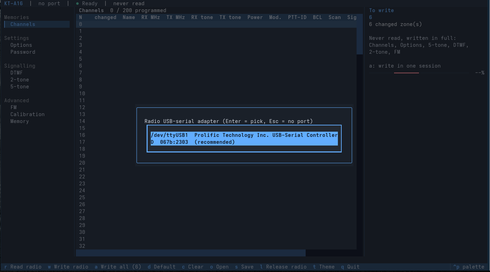
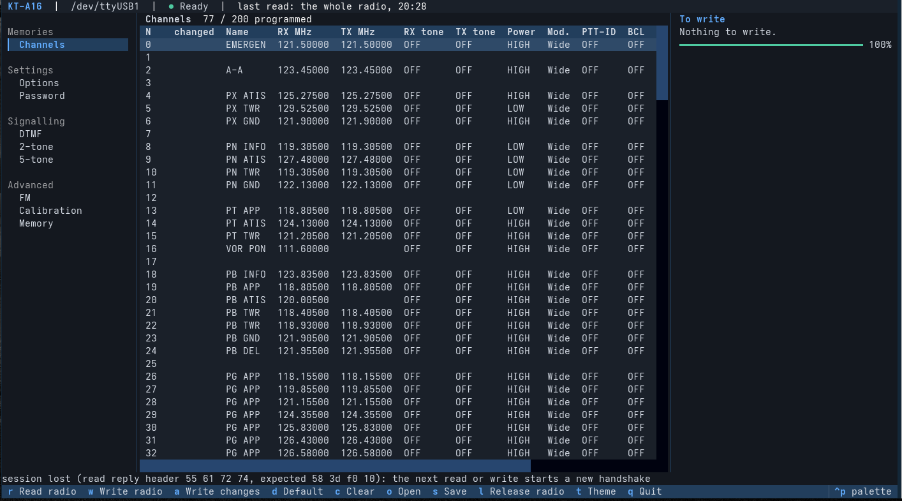
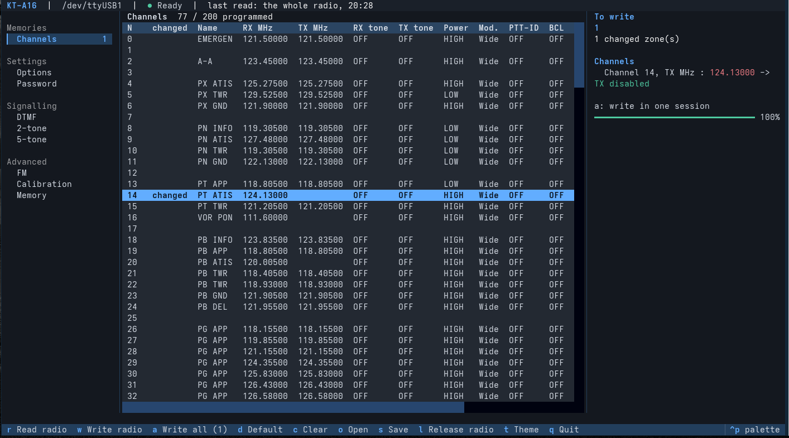
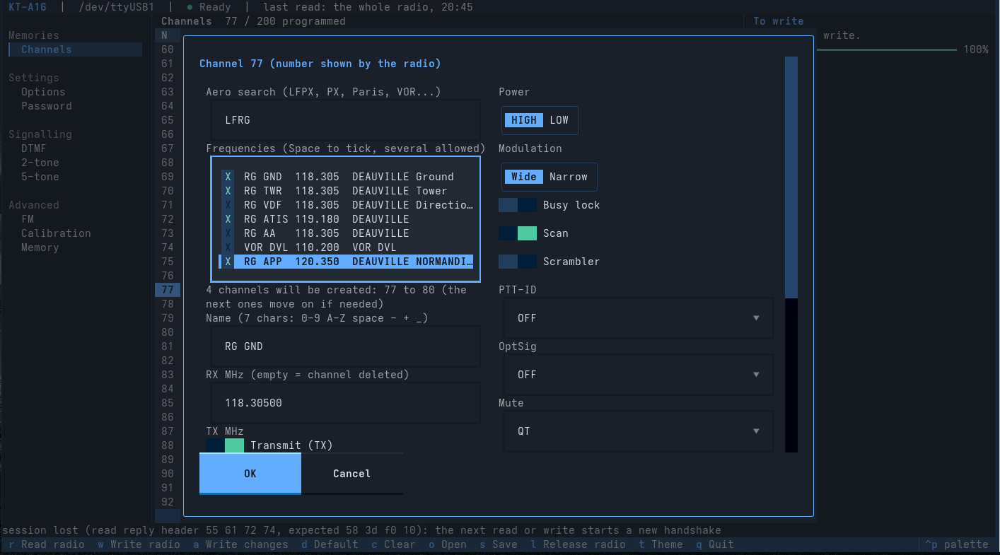
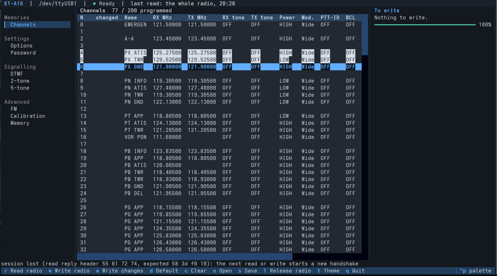

# kta16: program the QYT KT-A16 radio from Linux

[](pyproject.toml)
[](https://www.repostatus.org/#active)
[](LICENSE)
[](https://github.com/pierrehenrymuller/radio-qyt-kt-a16/actions/workflows/tests.yml)
[](https://github.com/pierrehenrymuller/radio-qyt-kt-a16/actions/workflows/build.yml)
[](https://github.com/pierrehenrymuller/radio-qyt-kt-a16/actions/workflows/codeql.yml)
[](https://github.com/pierrehenrymuller/radio-qyt-kt-a16/actions/workflows/tests.yml)
[](https://github.com/pierrehenrymuller/radio-qyt-kt-a16/releases)

> [!WARNING]
> **Transmitting on the aviation bands is forbidden without an aeronautical
> radiotelephony licence or a pilot licence.** This tool can program a radio
> to transmit on aviation frequencies. It does not prevent it: you are
> responsible for following the radio regulations of your country.

A terminal program (TUI) that does what the vendor Windows software
`KT_A16_CPS.exe` does: channels, options, DTMF, 2-tone, 5-tone, FM
stations, calibration and passwords. No Windows, no Wine.

[Version française](README.fr.md)

> This project is not affiliated with QYT. It was written by studying the
> vendor software for interoperability; no vendor file is included. Writing
> to a radio, and above all to its calibration, is at your own risk: keep
> the backups the tool makes.

The user interface is in French; this guide gives the English meaning of
each label.

## What you need

- Linux, Python 3.11 or later, [uv](https://docs.astral.sh/uv/) (or pipx).
- The radio and its USB programming cable (Prolific PL2303 chip, seen as
  `/dev/ttyUSB0`).
- Read and write access to the serial port. The port belongs to a group
  (`dialout` on Fedora and Debian, `uucp` on Arch): check with
  `ls -l /dev/ttyUSB0`, then add yourself to it and log in again.

```
ls -l /dev/ttyUSB0
sudo usermod -aG dialout "$USER"
```

## Install

From a clone of this repository, either as a command:

```
uv tool install .
kta16 --help
```

or in a local virtual environment, with the Makefile:

```
make venv
make test
```

`make clean` removes the virtual environment and caches.

## Start

Try it first without a radio, with the built-in emulated radio:

```
kta16 --emulator
make emulator
```

With demo channels (an ATIS, a tower, two VOR...), for screenshots or a first look:

```
make demo
make demo LANG_OPT="--lang en"
```

With the real radio, without a port: a list of the USB-serial adapters opens at
start, the Prolific PL2303 cable (`067b:2303`) first and marked recommended;
Esc starts without a port. The list opens again after an error on the port
(cable pulled, adapter renumbered):




```
kta16
make run
```

With a known port, no list:

```
kta16 --port /dev/ttyUSB0
make run PORT=/dev/ttyUSB0
```

Choose the interface language (see "Interface" below):

```
kta16 --lang en --port /dev/ttyUSB0
```

Open an image file at start:

```
kta16 --port /dev/ttyUSB0 myradio.dat
```

## Rules for the real radio

- The radio must show its normal screen before each read or write.
- Opening the port does not restart the radio (measured), so the first read
  or write of a launch goes straight to the handshake. It opens a session that
  stays open while the application runs: a read of the password block every second keeps the
  radio in it, so reads follow each other without a restart, and a write
  after a read needs no restart before it. A write ends the session: the
  radio leaves it about 1.7 s after the last frame and restarts, with the
  vendor software too (measured), so the next read or write waits for the
  warning screen again: a window asks you to go past it (Exit three times)
  to the normal screen, then OK, and the handshake is sent only after OK. The
  radio shows "Read" from time to time and is not
  usable as a radio meanwhile. `l` (release radio) or quitting closes the
  port: the radio restarts, answers again about 10 s after a write and about
  110 s after a full read. If it shows a blue warning menu, press Exit three
  times.
- If the session is lost (cable pulled, radio switched off), the status bar
  says so and the next read or write starts a new handshake.
- The tool sends one handshake per session and never retries on its own:
  repeated handshakes make the radio restart in a loop. If a session
  fails, wait for the normal screen and press the key again.
- Channels are numbered from 0, as on the radio and in the vendor
  software.

## Interface



- The sidebar on the left groups the screens: Memories (channels), Settings
  (options, password), Signalling (DTMF, 2-tone, 5-tone) and Advanced (FM,
  calibration, hex memory), with the number of pending changes next to each
  screen. The top bar shows where the radio is (port or simulated), a light
  (ready, session open, or a read or write running) and when it was last read.
- The panel on the right, "To write", lists every change that is not in the
  radio yet, with the value before and after. A zone this session never read
  is listed once: it is written in full. Rows changed in the channel list are
  marked "changed", and the footer shows how many zones `a` will write.


- Two themes: Atelier (dark, the default at every start) and Papier (light).
  `t` switches during the session.
- Two languages: French and English. The language follows your locale
  (`LC_ALL`, `LC_MESSAGES`, then `LANG`): French if the value starts with
  `fr`, English for any other value. `--lang fr` or `--lang en` forces it.
  Names taken from the vendor software (for example "Squelch Level",
  "Group Code") stay in English.

## Keys

| Key | Label | Action |
|---|---|---|
| `r` | Lire radio | read the whole radio in one session (about 45 s); on the Memory tab, only the zone chosen there |
| `w` | Écrire radio | write the zone of the current tab |
| `a` | Écrire modifs | write, in one session, every zone changed since the last read or write |
| `l` | Libérer la radio | close the port: the radio restarts and can be used again |
| `d` | Défaut | put the "Default" values of the vendor software in the zone of the current tab |
| `c` | Effacer | "Clear" of the vendor software (Channels and FM tabs) |
| `o` | Ouvrir | open a file |
| `s` | Enregistrer | save to a file |
| `t` | Thème | switch between the dark and the light theme |
| `q` | Quitter | quit; asks first if changes are neither written nor saved |

Every change is made in the image held in memory; the radio is only
touched by `r`, `w` and `a`. Before any write, a timestamped copy of the
image is saved in `~/.local/share/kta16/backups/` (folder readable by you
only, the image holds the radio passwords).

## A typical session

1. `r`: full read of the radio (about 45 s).
2. `s`: save it, for example `myradio-backup.img`.
3. Change what you want in any tab.
4. `a`: the changed zones are written in one session, so the radio
   restarts once, at the end.
5. `r` again later to check, and `o` then `w` on zone `all` to put the
   backup back if needed.

`a` never writes the calibration nor the passwords: use `w` on their
tab. A zone never read nor written in this session counts as changed, so
after opening a file `a` writes all data zones.

## Tabs

### Canaux (channels)

200 channels, every property in its own column. Select a row and press Enter
to edit it:



To move channels, press Space on a row, then the up and down arrows: the
channel swaps with its neighbour and the cursor follows. To move several at
once, select a block first: Shift+up or Shift+down from the first channel, or
a click on the first one then Shift+click on the last (selected rows are
shown in reverse). Space picks the selection up, the arrows move it, Space or
Enter drops it, Esc puts it back where it started (Esc alone clears the
selection; so do a plain arrow or a click). Channel numbers kept in the options
(current channel of side A, `0x0E65`) do not follow the move.



Name (up to 7 characters: `0-9 A-Z`, space, `-`, `+`, `_`; the vendor
software stops at 6 and refuses the symbols, the radio accepts them), RX and
TX frequency in MHz (`145.50000`),
CTCSS/DCS tones and signalling code on the left; power (HIGH, LOW) and
modulation (wide, narrow) as buttons (left and right arrows, or a click),
busy lock, scan and scrambler as switches, PTT-ID, optional signal and
speaker mute on the right. A TX frequency outside the bands the radio reports
shows a warning under the field (not shown while the band limits are unknown,
for example on an image never read from the radio or a file); you can still apply it. An empty RX
frequency deletes the channel; the "Transmit (TX)" switch above the TX box is on every channel: Off hides
the box and writes 200 MHz as TX, a frequency where the radio does not
transmit (an empty TX does not stop it, see `docs/protocol.md`); an empty TX
box is written the same way. In the beacon band (108 to 117.975 MHz) TX stays
empty. On with an empty box copies the RX frequency. The
OK and Cancel buttons stay in view whatever the terminal size.

The "Aero search" box at the top of the dialog looks up French aeronautical
frequencies: type an ICAO code (`LFPX`), its two last letters (`PX`), a
word (`Paris`, `VOR`) and pick a line in the list. Name and RX are filled
in (`PX GND`, `PX TWR`, `PX ATIS`, `PARINFO`...). TX takes the RX
value, except for an ATIS and for beacons (VOR, ILS, 108 to 117.975 MHz): the
"Transmit (TX)" switch is then set to Off. The 200 MHz is never shown: blank
in the channel list, "TX désactivé" in the pending changes. An aerodrome whose name holds "VOR" (AVORD) keeps TX = RX.

Several lines can be ticked (Space): the first one fills the form, and OK
creates one channel per ticked line from the current channel on, with the
settings of the form (power, tones, switches) and the TX rule of each line
(ATIS 200 MHz, beacon empty, otherwise TX = RX). The free channels right
at the current place are used first; every channel after them then moves on
by the number of places still missing (empty channels in between are kept). If the last
channel would go past channel 199, nothing changes and a message says so.

The data comes from the SIA (Licence Ouverte,
file `kta16/aero.json`): radio services of the 441 aerodromes (eAIP pages
for the IFR ones, completed by the header of the VAC chart in PDF, the only
source for the others), VOR of
the aerodromes and en route (`VOR AJO`), flight information such as Paris
Information. `make aero` rebuilds it from the current AIRAC cycle (every 28
days, no account needed; it needs `pypdf`, installed by `make venv`). Three
aerodromes have no frequency in the SIA files (LFFW, LFIF, LFKK); the build
fails if more than 10 VAC give nothing (PDF layout changed).

### Options

The lists of the vendor option screen (squelch, TOT, VOX, beep, scan,
colours, TMR and so on) and the three frequency lines A, B and C of the radio screen (the vendor
software calls them "frequency models"; each block of the tab starts with the
frequency of its line). Type in the boxes
and press Enter:

| Box | Example |
|---|---|
| Line frequency, MHz `999.99999` | `145.50000` |
| Line offset, MHz `999.999` | `000.600` |
| Line RX tone | `88.5` (CTCSS), `D023N` (DCS) or `OFF` |
| Line TX tone | `D023N` |

### DTMF

Fifteen encode codes, the decode codes (inspection, monitor, alarm, stun,
kill, revive, master and vice ID), group and space codes, speeds, reset
and delay times in ms, control rights and RX/TX disable. Fill the boxes,
then press the button "Appliquer à l'image" (apply to the image).

### 2-tone

One command per line in the box, then Enter:

| Command | Meaning |
|---|---|
| `enc 1 1981 1124` | encode code 1: first and second tone in Hz |
| `enc 2 -` | clear encode code 2 |
| `tones 1 1000 1500 - -` | decode tones A B C D of code 1 (`-` = none) |
| `dur 600 600 300` | first tone, second tone and gap, in ms |
| `reset 6000` | decode reset time, 100 to 8000 ms |
| `dec 1 A-B 1 0 A-C 1 0 A-D 1 0 B-C 1 0` | decode code 1: four pairs, each with a response 0 to 3 and an alert |

### 5-tone

| Command | Meaning |
|---|---|
| `tone 0 0 1981` | standard 0 (CCIR1), digit 0, frequency in Hz |
| `std 0 100 A E` | standard 0: period in ms, group tone, repeat tone |
| `enc 1 12345 - - CCIR1` | encode code 1: three frames of 5 hex digits (`-` = empty) and the standard |
| `delays 200 200 200 0` | delays 1 to 3 and first digit extend, in ms |
| `dec CCIR1 1 23 6000` | decode standard, frames that call, frames shown, reset in ms |

The button "Tables standard du CPS" puts back the standard tone tables
the vendor software writes.

### FM

The vendor software has a list of 16 broadcast FM stations. Whether the
KT-A16 has a broadcast FM receiver is not established; this zone is empty
on the radio studied.

| Command | Meaning |
|---|---|
| `1 98.3 RADIO` | station 1, MHz, name up to 8 characters |
| `1 -` | clear station 1 |

### Calibration

The hidden "Adjust" screen of the vendor software: TX power per band and
frequency, squelch, RF output, PA, audio gains, VOX thresholds, band
limits. Command `key index value`, with the key shown in the first
column, for example `vox_threshold 0 127`. Writing this zone to the radio
asks you to type `CALIBRATION`. Wrong values can make the radio unusable:
change it only if you know what you are doing, with a full backup.

### Mot de passe (passwords)

Two 6-digit passwords (empty = none), then "Appliquer à l'image" and `w`.

### Mémoire (memory)

Hex view of each zone; zone `all` is the whole image, as "Read from
radio" and "Write to radio" of the vendor software. Change bytes with
`address=bytes`, for example `0e02=06` (squelch 6). Calibration and
password bytes are refused here; use their tabs.

## Files

| Extension | Content |
|---|---|
| `.img` | raw 16 KiB image |
| `.dat` | text file of the vendor software (full image, 1025 lines); every vendor screen saves this |
| `.adj` | text file of the vendor "Adjust" screen: calibration and passwords only, merged into the current image when opened |

## Tests and development

```
make venv lint test
make coverage   # tests with line coverage (coverage.xml)
make package    # wheel and source archive; the wheel installs and starts
make audit      # known vulnerabilities in the dependencies (pip-audit)
make secrets    # secrets in the git history (gitleaks, through podman if needed)
sh .github/ci.sh                         # tests, build and audit in one run
sh .github/alpine.sh .github/tests.sh    # the same in the CI Alpine image
```

The tests drive the TUI against the emulated radio; no radio is needed.

GitHub Actions (`.github/workflows/`) only call the scripts of `.github/`, which
run the same way locally. The jobs run on the Ubuntu runner, and
`.github/alpine.sh` runs the scripts with podman in `ghcr.io/astral-sh/uv:alpine`
(latest uv, latest stable Python through `uv python install 3`), so the
JavaScript actions such as checkout stay on the host:

- `tests`, on every push and pull request: lint and tests with coverage. On
  `main`, the coverage goes to the `badges` branch as a shields.io endpoint
  file (`.github/coverage-badge.sh`, with the `GITHUB_TOKEN` of the run: no
  third-party service, no token to create).
- `build`: wheel and source archive; the wheel installs in a fresh venv and
  starts.
- `security`: dependency audit (also every Monday, against fresh advisories)
  and secrets in the whole history with the gitleaks image.
- `codeql`: CodeQL analysis of the Python code (also every Wednesday).
- `aero`, every month and on demand: `make aero` rebuilds the aeronautical
  frequencies from the SIA and fails if their layout changed.
- `release`, on a `v*` tag: wheel and source archive attached to a GitHub
  release (the downloads badge counts them).
- Dependabot proposes updates of the Python dependencies and of the actions,
  which are pinned by commit hash.

To enable in the GitHub settings of the repository (Settings, Code security):
secret scanning with push protection, Dependabot alerts and security updates.
CodeQL runs from its workflow: leave its "default setup" off (they conflict).

## Technical documentation

- [docs/protocol.md](docs/protocol.md): serial protocol and memory map,
  with the evidence for each field.
- [docs/adr/0001-tui-stack.md](docs/adr/0001-tui-stack.md): design choices.
- [docs/release-notes.md](docs/release-notes.md): changes per version.

## Sources

The protocol was found by studying the vendor programming software, for
interoperability only; no vendor file is included. The software studied:

- `KT_A16_CPS.exe`, inside the archive `KT-A16_CPS.rar` of the QYT download
  page (file `KT-A16_CPS/KT_A16_CPS.CAB`)
  <https://www.qytradio.com/category/downloads/1_3> (SHA-256
  `741fa6630dc0525e9f6d4bc84c8fbe8aff4e76cf5f8958969767b519468cf11c`).
- `8R_VIP_CPS.exe` of the QYT 8R, a related program (same code base),
  listed as `8R_VIP_CPS.rar` on the Radtel page
  <https://www.radtels.com/pages/software-download> (archive SHA-256
  `db12d73ccef6e3dedf7ae25e607268788c3c42a1121214146fd2e024f8a9237b`,
  executable `bcf3fef735e8e98a5a2ce119bc98dc862bb2d82edf9fcd5d0bb5df2e9f98259f`).
- Aeronautical frequencies: SIA eAIP France and VAC charts
  <https://www.sia.aviation-civile.gouv.fr>, Licence Ouverte.

## Licence

GPL-3.0-or-later, see [LICENSE](LICENSE).
